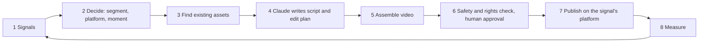
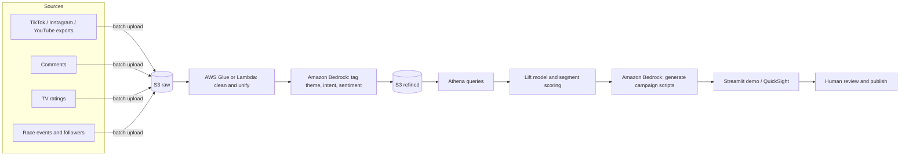

# Fan Growth Engine: Strategy and Approach

Challenge: *"How can we combine social media and TV data to help F1 Academy reach more young fans and grow the under-25 fanbase by 20%?"*

Audience of this document: the team and mentors (working document).
Companion document: [Real-world data approach](./real-world-data-approach.md) (for the judges' discussion).

> **Data honesty note.** The team names, venues and 2026 race calendar are real and public. Every driver, fan, comment and **every number in this document is synthetic**, generated by [`data/generate_data.py`](../data/generate_data.py). The insights show how the engine works. They are not findings about the real F1 Academy audience.

---

## 1. Summary

**Customer:** F1 Academy marketing and fan-engagement team.
**Problem:** Fans under 25 live on short-form video, but F1 Academy data sits in separate silos (TV ratings, platform analytics, comments), so nobody can see who is missing or what would win them.
**Solution (two prongs):**

| Prong | What it does | Status |
|---|---|---|
| **Growth** (this document) | Joins social and TV data into one pipeline, finds underserved young audiences, learns which content works for them, and uses Amazon Bedrock to generate tailored campaign scripts | To build and demo |
| **Retention** | The team's app that keeps new fans interested | Already built. Growth content links into it |

**Benefit:** a repeatable, data-backed way to close a gap of about **50,000 under-25 followers** (synthetic baseline) and reach the +20% goal.

**What the synthetic data shows (the story to tell):**
1. Under-25s are only **about 10% of the TV audience**, and teens leave mid-race (they retain 88% of their early audience by the end, versus 99% for 35+).
2. Short videos (30 seconds or less) with a strong opening hook get **about 2x the median views** of everything else (104k vs 53k) and a younger audience (48% under-25 vs 42%).
3. Race recaps, which are 19% of posts, have the **lowest** under-25 reach of any theme, and videos over 3 minutes reach the fewest young viewers.
4. Comments on STEM and driver-story posts carry the most "new fan" signals (35% and 30% of their comments ask who she is, where to watch, or how to start).

---

## 2. Data strategy

### 2.1 Principle
Land everything as it arrives (**raw**), then produce a cleaned, unified copy (**refined**) that the model and dashboards read. The raw layer is never edited, so any step can be replayed.

### 2.2 Sources

| Source | What we ingest | Raw format | Hackathon method |
|---|---|---|---|
| TikTok, Instagram, YouTube posts | Caption, hashtags, duration, views, likes, shares, saves, watch %, audience age/gender/country | Nested JSON, platform-native field names | Batch upload of curated JSON to S3 |
| Fan comments | Text, time, pseudonymous author id, likes | JSON | Batch upload |
| TV ratings (Nielsen-style) | Minute-by-minute viewers by region and age band | CSV | Batch upload |
| Race context | Calendar, session events (crash, overtake, safety car) | CSV | Batch upload |
| Followers snapshots | Monthly followers by platform and age band | CSV | Batch upload |
| Platform benchmark | What a healthy age mix looks like on each platform (**assumption**) | CSV | Batch upload |

We deliberately skip live scrapers and OAuth flows. A reliable batch upload is the demo guarantee. The real-world version is described in the [companion document](./real-world-data-approach.md).

### 2.3 Raw versus refined

| Layer | Folder | Deliberate "mess" in the raw data | What the refine step does |
|---|---|---|---|
| **Raw** | [`data/raw/`](../data/raw) | Different field names per platform (`play_count`, `plays`, `view_count`), three timestamp formats, YouTube watch % on a 0-100 scale, 5 duplicate posts, 25 duplicate comments, 38 missing watch values, 44 missing TV minutes, mixed region codes (`GB` and `UK`) | |
| **Refined** | [`data/refined/`](../data/refined) | | Unifies the schema, removes duplicates, rescales watch %, fills missing watch % with the median for the same platform and duration, normalises region codes, and adds tags: theme, hook type, duration bucket, sentiment, intent, language, age hint, interest |

### 2.4 Refined tables

| Table | Rows | Purpose |
|---|---|---|
| `posts_enriched` | 500 | One row per post with unified metrics and content tags |
| `comments_tagged` | 4,975 | Sentiment, intent, language, age hint, adjacent interest, spam flag |
| `tv_by_age_band` | 312 | Average and peak viewers, share of audience, late-vs-early retention |
| `tv_event_uplift` | 24 | How much each age band reacts to crashes, overtakes and so on |
| `content_performance` | 118 | Views, engagement and under-25 reach lift per theme, hook, duration, creator, posting time |
| `audience_segments` | 6 | Opportunity score and best platform, theme, hook and length per segment |
| `growth_baseline` | 4 | Under-25 followers, +20% target, and the gap |

### 2.5 Tagging approach
In the offline demo, tags come from transparent keyword rules in [`data/refine_data.py`](../data/refine_data.py). In the AWS build, **Amazon Bedrock (Claude)** produces the same columns, so the schema stays identical. A useful judge answer: *rules gave us a repeatable baseline, and Bedrock lets us handle slang, sarcasm and other languages.*

---

## 3. Audience identification

### 3.1 Idea
F1 Academy cannot win everyone. Look for people where **interest is visible but F1 Academy reach is low**. Those are the underserved young fans.

### 3.2 Candidate segments

| ID | Segment | Age | Why they might care |
|---|---|---|---|
| S1 | Teen Scrollers | 13-17 | Short, personality-led video is their default |
| S2 | Women's-sport crossover fans | 18-24 | Already follow women's leagues |
| S3 | Gamers and sim racers | 18-24 | Know the F1 games, curious about real racing |
| S4 | Future STEM girls | 13-17 | "Real girls driving and engineering" is a direct role-model pitch |
| S5 | Drive-to-Survive curious | 18-24 | Story-first, drawn in by characters and rivalry |
| S6 | Data lovers | 18-24 | Telemetry and lap-time nerds |

### 3.3 Signals from multi-modal data

| Signal | Source | Used for |
|---|---|---|
| Follower age mix versus platform benchmark | followers snapshots, benchmark | **Follower gap** (who is missing) |
| Interest mentions ("found you through my WNBA feed", "I'm studying engineering") | comments | **Size** of the interest |
| Intent: who is she, where to watch, how do I start | comments | **Conversion readiness** |
| Mentions in later half versus earlier half | comments over time | **Momentum** |
| Engagement rate on content aimed at them | posts | **Engagement intensity** |
| Age hints ("I'm 15", "year 10", "my daughter") | comments | Profiling teens without personal data |
| Under-25 share and mid-race drop-off | TV | Timing, not scoring |

### 3.4 Scoring formula
Each input is min-max normalised across the six segments, so the score is a **relative ranking**, not a probability.

```
opportunity = 100 x ( 0.30 x size
                    + 0.25 x follower_gap
                    + 0.20 x conversion_readiness
                    + 0.15 x momentum
                    + 0.10 x engagement_intensity )
```
The weights are our judgement and are easy to challenge. Show that you chose them. The demo app does not yet let a user change them; a future dashboard could.

**What each input measures** (code: `build_segments()` in [`data/refine_data.py`](../data/refine_data.py)):

| Input | Weight | Measures | How it is calculated |
|---|---|---|---|
| `size` | 0.30 | How much interest we can see | Count of non-spam comments that mention the segment's interest (for example "WNBA", "engineering"). For Teen Scrollers: comments with a teen age hint such as "I'm 15". Column: `interest_signal_comments` |
| `follower_gap` | 0.25 | How under-represented the age band is | Platform benchmark share minus F1 Academy's follower share for that age band, never below 0 |
| `conversion_readiness` | 0.20 | How close they are to becoming fans | Share of those comments that ask "who is she?", "where to watch?" or "how do I start?" |
| `momentum` | 0.15 | Whether interest is growing | (comments in the later half of the season + 1) / (earlier half + 1) - 1 |
| `engagement_intensity` | 0.10 | How strongly they react to the content | Engagement rate of the segment's posts, weighted by views and by the age band's share of each post's audience |

**Normalising.** For each input: `(value - lowest of the six) / (highest of the six - lowest of the six)`. The best segment gets 1 and the worst gets 0 on that input.

**Worked example: Future STEM girls (score 60.8)**

| Input | Value | Lowest to highest across the six | Rescaled (0 to 1) | Weight | Points |
|---|---|---|---|---|---|
| `size` | 175 | 67 to 410 | 0.315 | 0.30 | 9.5 |
| `follower_gap` | 0.071 | 0.013 to 0.071 | 1.000 | 0.25 | 25.0 |
| `conversion_readiness` | 0.406 | 0.209 to 0.406 | 1.000 | 0.20 | 20.0 |
| `momentum` | -0.175 | -0.175 to 0.240 | 0.000 | 0.15 | 0.0 |
| `engagement_intensity` | 0.099 | 0.071 to 0.115 | 0.636 | 0.10 | 6.4 |
| **Total** | | | | | **60.8** |

The same maths for the lowest-ranked segment, Data lovers (score 5.3): they score 0 on size, gap, readiness and engagement. Their only points come from momentum: 0.352 x 0.15 x 100 = 5.3.

**Caveats to state out loud:**
- The weights are judgement, not measured. A sensitivity check (trying other weights to see if the top three change) has **not** been run yet.
- `follower_gap` is the same for every segment in an age band (0.071 for both 13-17 segments, 0.013 for all 18-24 segments), so it mainly separates teens from the rest.
- Teen Scrollers' `size` (76) only counts comments with an explicit age hint, so they are probably undercounted. Their third place is partly a limit of the method.
- The data is synthetic, so the ranking shows how the method works, not what the real audience looks like.

### 3.5 Result on the synthetic data

| Rank | Segment | Score | Best platform | Best hook | Best length |
|---|---|---|---|---|---|
| 1 | Future STEM girls (13-17) | 60.8 | TikTok | POV | 0-15s |
| 2 | Drive-to-Survive curious (18-24) | 51.4 | TikTok | POV | 0-15s |
| 3 | Teen Scrollers (13-17) | 50.9 | TikTok | POV | 0-15s |
| 4 | Gamers and sim racers | 32.7 | TikTok | POV | 61-90s |
| 5 | Women's-sport crossover fans | 29.8 | TikTok | Story tease | 0-15s |
| 6 | Data lovers | 5.3 | TikTok | Story tease | 0-15s |

**Reading it:** the biggest hole is **13-17**. Their share of followers is **7.2% versus a 14.4% benchmark**, while the 18-24 share is close to the benchmark. So the 18-24 groups need *conversion* (move them from scrolling to watching), and the 13-17 groups need *reach*. Pick the top three as primary targets.

### 3.6 Personas
Turn each top segment into a one-page persona: a name, age, platforms, what she scrolls, what makes her stop, what she comments, and the call to action that converts her. Bedrock can draft these from the refined tables, and the team edits them.

---

## 4. Growth and content pitch

### 4.1 Goal and baseline

| Item | Value (synthetic) |
|---|---|
| Baseline under-25 followers (30 Sep 2026) | 421,206 (35.8% of 1,175,381) |
| Target (+20%) | 505,447 |
| Horizon | 6 months, to 31 Mar 2027 (**assumption: confirm with the organiser**) |
| Organic growth today | about 1.3% per month, which reaches about 455,000 |
| Required growth | about 3.1% per month |
| **Gap to close** | **about 50,400 followers** (TikTok 21.5k, Instagram 22.5k, YouTube 6.3k) |

### 4.2 What the model learns
The v1 model is an **explainable lift table** (`content_performance`). For every content attribute it reports views, engagement, and an **under-25 reach index**: median views multiplied by the under-25 share, relative to the platform average. A value above 1 means better than average for young reach.

| Attribute | Best | Worst |
|---|---|---|
| Theme | memes/trend (2.02), fashion/lifestyle (1.72), driver story (1.44) | race recap (0.38), data explainer (0.56) |
| Hook | POV (1.50), story tease (1.44), question (1.32) | no hook (0.70) |
| Length | 0-15s (1.67), 16-30s (1.59) | over 5 minutes (0.24) |
| Creator | drivers (1.77) | official channel (0.76), which posts 44% of content |
| Posting time | 15:00-21:00 UTC (1.14) | other hours (0.88) |

v2 (stretch goal): a gradient-boosted model in scikit-learn, or Amazon SageMaker, that predicts views and under-25 share from attributes. Keep v1 for the demo because judges can follow it.

### 4.3 Content pillars

| Pillar | Format | Target segments | Evidence (synthetic) |
|---|---|---|---|
| **Meet the driver** | 15-20s POV or story-tease clips | S5, S1 | Driver stories: reach index 1.44, 30% new-fan signals |
| **Girls in STEM** | 15s engineer spotlights | S4 | Highest conversion readiness (41%) |
| **Race in 30 seconds** | Reverse-grid chaos and overtakes | S1, S5 | Reverse grid: index 1.14 |
| **Helmet and fit check** | Lifestyle clips | S1, S2 | Fashion: index 1.72 |
| **Sim versus real** | 60-90s challenge | S3 | Best length for gamers is 61-90s |

Stop or reduce: race recaps and videos over 3 minutes as the main format. Keep them for existing older fans on YouTube.

### 4.4 TV insight: timing and clipping
- Under-25s are about **10% of the TV audience** (13-17: 3.4%, 18-24: 6.6%).
- Teens keep only **88%** of their early audience by the end of a session, against **99%** for 35+.
- **Crashes** lift teen viewing by **+32%** (versus +18% for 35+). **Overtakes for the lead** lift it by **+21%** (versus +10%).

**Use:** clip the moments that spike young viewing and post them within minutes, on the platforms young fans use, with a link back to the live stream.

### 4.5 Bedrock campaign generator

**Input:** persona, platform, theme, hook, length, race weekend context, brand-safety rules.
**Output:** three script variants (hook, shot list, caption, hashtags, call to action), each with a short reason tied to the data.

Prompt skeleton:
```text
You are a social content strategist for F1 Academy.
Audience: {persona} ({age_band}, {platform}).
Data says: {top_pattern_1}; {top_pattern_2}; {top_pattern_3}.
Race context: {round}, {venue}, {event_hook}.
Write 3 {length}-second video scripts. Each needs: opening hook (first 3s),
shot list, caption, 3 hashtags, and a call to action to {retention_app_or_stream}.
Rules: respectful, empowering, no personal data, no claims about real
individuals that are not in the context, family-friendly language.
```
Use **Bedrock Guardrails** for safety, and require **human approval** before anything is published.

> **Checked on 10 Oct 2026 in this project (`us-east-1`):**
> - Bedrock works. A test call to Claude Haiku 4.5 (via the `us.anthropic.claude-haiku-4-5-20251001-v1:0` inference profile) returned scripts for two segments. See [`demo/sample_campaign_scripts.txt`](../demo/sample_campaign_scripts.txt).
> - **Claude 3.5 Sonnet is not in this project's model list.** Active Claude models include Haiku 4.5, Sonnet 4.6 and Sonnet 5; Nova Pro, Lite and Micro are also active. Only Haiku 4.5 was tested.
> - **Nova Reel (video), Nova Canvas and Titan Image Generator return "end of life".** The only image models listed are Stability editing tools, which need an input image. So video and image **generation is not available** here, and the flow in 4.6 uses existing footage.
> - Re-check the model list before the demo, because availability changes.

### 4.6 From signal to published video (end to end)

In the real world, most videos are **assembled from footage F1 Academy already owns**. Generative video is only a gap-filler, and it is not available in this project. The flow turns an audience signal into a short video posted where the signal came from.



| Step | What happens | AWS building blocks | Our data / status |
|---|---|---|---|
| **1. Signals** | Comment intent ("who is she?"), a post trending with a segment, a TV spike after a crash or overtake, a follower-gap alert | S3, Athena, Bedrock tagging, EventBridge | `comments_tagged`, `tv_event_uplift`, `growth_baseline` |
| **2. Decide** | Pick the target segment, platform and format (for example, a 15s POV for Future STEM girls on TikTok) | Scoring and lift model in Lambda | `audience_segments`, `content_performance` |
| **3. Find assets** | Search the existing library (race footage, interviews, paddock clips, photos) for the moment and theme | Footage indexed once with Rekognition, Transcribe and Titan multimodal embeddings, then a vector index such as OpenSearch Serverless | Not built. Hackathon plan: a fictional clip catalogue (about 30 rows) |
| **4. Script and edit plan** | Claude receives the segment, signal, data insights and the matched clips, and returns a script, caption and an edit decision list (clip IDs, in/out times, text overlays) | Amazon Bedrock (Claude), Bedrock Guardrails | Tested with Haiku 4.5 on two segments |
| **5. Assemble** | Cut, crop to 9:16, add captions and music | AWS Elemental MediaConvert, or FFmpeg in Lambda or ECS. Generative visuals only for missing b-roll | Hackathon: show as a storyboard |
| **6. Check and approve** | Brand safety, driver likeness, music and broadcast rights, minors, then human sign-off | Guardrails, an approval step (Step Functions) | Hackathon: an Approve button |
| **7. Publish** | Post from F1 Academy's own accounts to the platform where the signal came from | Instagram Graph API publishing, YouTube Data API, TikTok's posting API (all **to confirm**); a scheduling tool is the fallback | Hackathon: mock publish preview |
| **8. Measure** | Compare against a control and feed results back into the model | Athena, QuickSight | Austin as the pilot |

**Slide-ready diagrams** (PNG, SVG and editable Mermaid source) are in [`docs/diagrams/`](./diagrams): `signal-to-video-flow` and `data-architecture`. Colour key for the flow diagram: purple = AI, blue = automation, green = human approval, dashed border = mocked in the hackathon demo.

**Worked example (hypothetical, synthetic numbers).** Signal: imagine a crash in the Austin Feature Race (Austin has not happened yet), the teen audience on TV rises (+32% in our data) and comments on a related post ask "who is she?". Decision: Teen Scrollers, TikTok, 15s POV, posted within minutes. Assets: the crash replay, the driver's pre-race interview, a helmet close-up. Claude returns the hook, the shot order and a caption pointing to the app. A person approves, and the video goes to TikTok. Next day, completion rate and follower change are compared with the control.

**Rules to state out loud:**
- **Rights are the real constraint.** Broadcast footage and driver likeness need clearance, so the cleared library is the asset and the approval step matters.
- **Act on segments, never on individuals.** Do not auto-reply to or target a specific teenager.
- **"Same platform as the signal" is a default.** Step 2 can choose another platform if the data says so.
- **Publishing needs account approvals.** TikTok in particular may need app review. We have not verified current terms for any of the three publishing APIs.
- **Keep a human in the loop** until results show the process is safe.

**Hackathon scope.** Build steps 1, 2, 4 and 6 for real. Mock steps 3, 5 and 7 with the fictional catalogue, a storyboard and a preview. Plan: a Streamlit page where you pick a signal and segment, see the matched clips, and get a Claude-written script and edit plan with an Approve button.

### 4.7 Pilot and measurement
- **Austin (23-25 Oct, a three-race weekend)** is the pilot: three variants per persona.
- **Las Vegas (19-21 Nov)** scales whatever won.
- Track: under-25 followers, completion rate, share rate, clicks to the retention app, new-fan comment share.
- Success after Austin: the winning variant beats the control by a margin you agree on before launch.

### 4.8 Link to retention
Every Growth video ends with a call to action into the existing retention app, so the journey is *discover on TikTok, then follow, then use the app, then watch the race*. Show this as one slide.

---

## 5. Architecture



This diagram covers the data and insight side. The signal-to-video flow (asset library, edit plan, assembly, approval, publishing, measurement) is in [section 4.6](#46-from-signal-to-published-video-end-to-end).

**Scalability story:** S3 and Athena are serverless and scale with data. EventBridge Scheduler can replace manual uploads with scheduled pulls. Glue handles larger volumes, and the same Bedrock prompts work for more segments and more series.

**Security:** private S3 buckets with Block Public Access and encryption at rest, least-privilege IAM, no personal data (pseudonymised ids only), and CloudTrail for audit.

---

## 6. Demo plan (Streamlit)

1. **Overview:** baseline, target and gap.
2. **Audience:** segment table and a gap chart (follower share versus benchmark).
3. **What works:** pick a persona and platform, and see the best theme, hook and length.
4. **Generate campaign:** click a button and Bedrock returns three scripts.
5. **TV timing:** the age-band uplift chart for crashes and overtakes.
6. **Signal to video (built):** the Streamlit app in [`demo/`](../demo) walks through the eight steps of section 4.6. Pick a signal, see the segment, platform and hook decision, search a fictional clip catalogue (Titan embeddings), get a Claude-written script and edit plan, run the safety and rights checks, then approve to see a mock publish preview.

Run it:
```bash
aws login --profile team-1          # refresh credentials (they last 12 hours)
pip install -r demo/requirements.txt
streamlit run demo/app.py
```
Use **Offline mode** in the sidebar as the backup. It loads saved Bedrock results from `demo/cache/`, so the demo still works without Wi-Fi or credentials.

Also record a **60-second backup video** of steps 3, 4 and 6.

---

## 7. 10-minute presentation plan

| # | Slide | Time | Key point |
|---|---|---|---|
| 1 | Problem and customer | 1:00 | Under-25s are missing and data is siloed |
| 2 | Our two-pronged solution | 0:45 | Growth brings them in, retention keeps them |
| 3 | Data strategy and architecture | 1:15 | Raw to refined on AWS, with the diagram |
| 4 | Audience identification | 1:15 | Segments, gap score, top three |
| 5 | Personas | 0:45 | Who she is and what stops her scroll |
| 6 | What works (model) | 1:00 | POV, 30s or less, driver stories |
| 7 | Live demo (signal to script and edit plan) | 2:00 | Persona and signal to Bedrock script, with the end-to-end flow shown on one diagram |
| 8 | Retention app and the fan journey | 0:45 | Growth feeds retention |
| 9 | Impact and roadmap | 0:45 | 50k gap, Austin pilot, Las Vegas scale |
| 10 | Real data and next steps | 0:30 | Link to the real-world approach |

---

## 8. Hackathon checklist mapping

| Requirement | Where it is covered |
|---|---|
| Clear problem, solution, customer, benefit | Sections 1 and 4 |
| 10-minute presentation with working demo | Sections 6 and 7 |
| Simple architecture diagram | Section 5 |
| At least one AWS AI service | Amazon Bedrock (tagging and generation) |
| Works, could grow, real or realistic data | Sections 2 and 5; synthetic data, clearly labelled |

---

## 9. Risks and open questions

| Risk or question | Plan |
|---|---|
| Synthetic data could be mistaken for findings | Label it in every slide and file |
| Bedrock model access or retirement | Claude 3.5 Sonnet is not available here and video/image generation models are retired; use an active Claude model (Haiku 4.5 tested) and re-check before the demo |
| No video or image generation in this project | Build the flow on existing footage; show storyboards; name a generative model as a future step |
| Footage, music and driver likeness rights | Use only cleared assets; keep the human approval step before publishing |
| Publishing API access and terms | Not verified for TikTok, Instagram or YouTube; use a scheduling tool or manual posting as the fallback |
| Minors in the audience | Aggregates and pseudonymous ids only; no profiling of individuals |
| Growth horizon is our assumption | Confirm with the organiser |
| Benchmarks are illustrative | Replace with platform insights in the real build |
| Rule-based tags are crude | Swap in Bedrock tagging and compare |

---

## 10. Reproduce the data

```bash
python data/generate_data.py   # raw layer (seeded, repeatable)
python data/refine_data.py     # refined layer
python data/validate_data.py   # 29 consistency checks
```
Standard library only; tested on Python 3.11.

Upload to S3 (replace the bucket name):
```bash
aws s3 sync data/raw     s3://<your-bucket>/raw/
aws s3 sync data/refined s3://<your-bucket>/refined/
```

---

## Appendix A: Key refined columns

**posts_enriched:** `post_id, platform, creator_type, posted_at, post_hour_utc, teen_prime_hour, round, race_weekend, duration_sec, duration_bucket, theme, hook_type, driver_featured, views, likes, comments, shares, saves, engagement_rate, share_rate, watch_pct, watch_pct_imputed, teen_share, young_adult_share, under25_share, female_share, top_countries, hashtags`

**comments_tagged:** `comment_id, post_id, platform, created_at, author_id, text, language, intent, sentiment, age_hint, adjacent_interest, is_spam, new_fan_signal, post_theme, like_count`

**audience_segments:** `opportunity_rank, segment_id, segment_name, primary_age_band, relevant_posts, interest_signal_comments, current_follower_share, benchmark_share, follower_gap, content_reach_share, engagement_intensity, conversion_readiness, momentum, tv_late_vs_early_ratio, opportunity_score, best_platform, best_theme, best_hook, best_duration_bucket`

## Appendix B: Notes on the synthetic data
- Race calendar: Rounds 1-4 (Shanghai, Montreal, Silverstone, Zandvoort) are completed and have data. Round 5 (Austin) and Round 6 (Las Vegas) are the campaign targets.
- Session times in the TV data are **illustrative**, not the real schedule.
- Teams: Prema Racing, Campos Racing, MP Motorsport, Rodin Motorsport, ART Grand Prix, Hitech. Drivers are fictional.
- The patterns the model finds were built into the generator on purpose (for example, short POV clips do better). That makes the demo reliable, and it is also why the numbers must never be presented as real.
