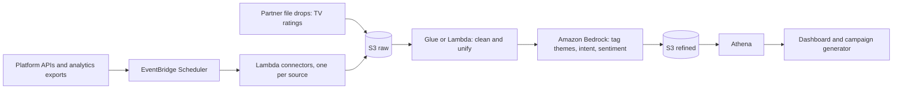

# Getting this data in the real world

Discussion document for the judges. It explains how the synthetic data in this project maps to data F1 Academy could actually provide.

Companion document: [Fan Growth Engine strategy](./fan-growth-strategy.md).

---

## 1. Core idea: the customer owns most of the data

F1 Academy owns its own social accounts and works with broadcast and measurement partners. So the realistic route is **authorised, first-party access**, not scraping. This is also the safer route for privacy, platform terms and brand trust.

| Principle | Why |
|---|---|
| Use the account owner's own analytics and APIs | Gives age, gender and country data that public pages do not show |
| Ingest aggregates, not individuals | Platform demographics are already aggregated, and our segments work at segment level |
| Keep the raw layer unchanged | Lets us replay and audit |
| Same schema, different feed | The synthetic files were shaped like real exports, so only the ingest step changes |

---

## 2. Source by source

| Data | Real source | Access route | Known limits | Our synthetic stand-in |
|---|---|---|---|---|
| **YouTube** posts and audience | YouTube Analytics API and Reporting API (bulk reports) | The channel owner authorises OAuth 2.0 access; reports include demographics | Owner or content-owner access only; some reports are for Partner Program content owners | `posts.json` (youtube rows) |
| **Instagram** posts and audience | Instagram Graph API insights | Business or Creator account authorises the app; returns follower age, gender, city and country | Owner-only; demographics need at least 100 followers; no follower list | `posts.json` (instagram rows) |
| **TikTok** posts and audience | The account owner's TikTok analytics export, or TikTok's developer / business APIs | Owner downloads reports, or authorises an app | We have **not confirmed** which audience fields TikTok's APIs return. TikTok's Research API is for eligible non-commercial researchers, so a brand project should not rely on it | `posts.json` (tiktok rows) |
| **Fan comments** | Each platform's comment endpoints for the owner's own posts, or a licensed social-listening tool | Owner authorisation, or vendor contract | Comment availability and terms vary by platform; **TikTok comment access is unconfirmed** | `comments.json` |
| **TV ratings** | Audience measurement data for F1 Academy broadcasts, licensed from broadcast and measurement partners | Contract and data-sharing agreement | Often delivered as files, in age bands, sometimes with a delay; minute-level data may cost extra or be unavailable | `tv_ratings.csv` |
| **Race context** | F1 Academy's published calendar and timing data | Public schedule; timing feed by agreement | Session times and event logs need an agreed source | `race_calendar.csv`, `race_events.csv` |
| **Followers over time** | Platform analytics, snapshotted monthly (or daily) by us | Owner analytics | Platforms rarely give long history, so **start snapshotting now** | `followers_snapshot.csv` |
| **Platform benchmark** | Platform audience insights or published market research | Licensed or public research | Our benchmark is an **assumption**; real values must be sourced | `platform_benchmark.csv` |
| **CRM, tickets, merch, app** | F1 Academy systems and the team's retention app | Internal export or API, with consent | Needs a data-sharing agreement and consent checks | Not simulated yet |

> **Not verified:** we have not confirmed current TikTok API fields or any TV measurement vendor's terms. We would confirm these with F1 Academy and each provider before committing to a design.

---

## 3. How it would run on AWS

- **Connectors:** a small Lambda per platform, with credentials in AWS Secrets Manager, never in code.
- **Cadence:** daily for social metrics, weekly for TV files, and a snapshot of followers every day.
- **Schema contract:** each connector outputs the same raw shape we simulated, so the refine step does not change.
- **Quality checks:** the checks in `data/validate_data.py` (duplicates, ranges, key integrity) run on each load.

---

## 4. Privacy and responsible use (many fans are minors)

| Topic | Approach |
|---|---|
| Personal data | Store aggregates and pseudonymous ids only. No names, handles or contact details in the refined layer |
| Minors | Do not profile or target individual under-18s. Work at segment level and follow platform rules for teen audiences |
| Consent and terms | Use only data the owner is entitled to share. Respect each platform's developer terms |
| Regional law | Check GDPR and local rules (the audience spans Europe, the Americas and Asia) |
| Retention | Keep raw comments only as long as needed; delete on request |
| Security | Private, encrypted S3 buckets, least-privilege IAM, audit logging |
| AI safety | Bedrock Guardrails plus human approval before anything is published |

---

## 5. Phased rollout

| Phase | Scope | Outcome |
|---|---|---|
| **0: Hackathon (now)** | Synthetic data, batch upload to S3 | Working demo |
| **1: Pilot (about 4 weeks)** | Owner exports from YouTube, Instagram and TikTok; one TV file; start follower snapshots | First real segment scores |
| **2: Automate** | Scheduled connectors, Bedrock tagging, dashboard | Weekly insights without manual work |
| **3: Expand** | CRM and app data, more regions, A/B test results feed the model | Closed loop: content, results, better content |

---

## 6. Risks

| Risk | Mitigation |
|---|---|
| Platform API changes or access limits | Keep manual export as a fallback; isolate each connector |
| TV data is delayed or coarse | Use it for patterns (timing, age mix), not for live decisions |
| Short history for trends | Start snapshots on day one |
| Self-reported age hints are rare | Treat them as supporting evidence only |
| Model bias toward what already works | Reserve part of the budget for experiments on new content |

---

## 7. Questions to discuss with the judges

1. Which data would F1 Academy realistically share first, and who approves it?
2. Is minute-level TV data available, or only per-session averages?
3. What is the right horizon and baseline for the +20% target?
4. How should we handle comments from minors when training or tagging?
5. What would make a Bedrock-generated script acceptable to publish?

---

## 8. Sources checked

- [YouTube Analytics API reference](https://developers.google.com/youtube/analytics/reference/): returns analytics for a channel or content owner.
- [YouTube Analytics API channel reports](https://developers.google.com/youtube/analytics/channel_reports): requests need OAuth 2.0 and channel ownership.
- [YouTube Reporting API](https://developers.google.com/youtube/reporting/v1/reports/): bulk analytics reports.
- [Instagram Graph API user insights](https://developers.facebook.com/docs/instagram-platform/instagram-graph-api/reference/ig-user/insights/): some metrics need at least 100 followers.
- [TikTok Research API](https://developers.tiktok.com/products/research-api/): for eligible non-commercial researchers.

Content was rephrased for compliance with licensing restrictions. Third-party blog posts that describe the Instagram demographics fields were used only as a secondary cross-check.
